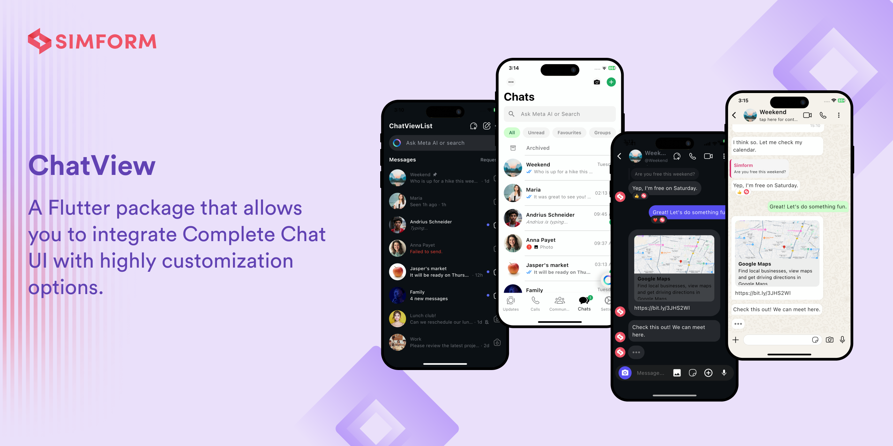

# ChatView

[](https://github.com/SimformSolutionsPvtLtd/chatview/actions) 
[](https://pub.dev/packages/chatview)
[](https://github.com/SimformSolutionsPvtLtd/chatview/blob/main/LICENSE)

ChatView is a Flutter package that allows you to integrate a highly customizable chat UI in your
Flutter applications with [Flexible Backend Integration][chatViewConnect].

| ChatList                                                                                                         | ChatView                                                                                                         |
|------------------------------------------------------------------------------------------------------------------|------------------------------------------------------------------------------------------------------------------|
|  |  |

## Features

### ChatList:

- Smooth animations for adding, removing, and pinning chats
- Pagination support for large chat histories
- Search functionality by name or other criteria
- Long press menu with options like pin and mute
- User online status indicators
- Typing indicators for active users
- Unread message count badges
- Header and Footer support for additional widgets
- Highly customizable UI components
- Plug-and-play backend support using [chatview_connect][chatViewConnect]

### ChatView:

- One-on-one and group chat support
- Message reactions with emoji
- Reply to messages functionality
- Link preview for URLs
- Voice messages support
- Image sharing capabilities
- Custom message types
- Typing indicators
- Reply suggestions
- Edit Message
- Message status indicators (sent, delivered, read)
- Highly customizable UI components
- Plug-and-play backend support using [chatview_connect][chatViewConnect]

For a live web demo, visit [Chat View Example](https://simformsolutionspvtltd.github.io/chatview/).

## Documentation

Visit our [documentation](https://simform-flutter-packages.web.app/chatView) site for all
implementation details, usage instructions, code examples, and advanced features.

## Installation

```yaml
dependencies:
  chatview: <latest-version>
```

## AI agent skills

This package ships [agent skills](https://dart.dev/tools/pub/package-skills) for coding agents
(Claude Code, Cursor, Copilot, Codex, …):

| Skill                  | Use it to                                                          |
|------------------------|--------------------------------------------------------------------|
| `chatview-chat-screen` | Build and customize a chat screen with `ChatView`                  |
| `chatview-chat-list`   | Build and customize the conversation list with `ChatList`          |
| `chatview-migration`   | Upgrade your app from its current `chatview` version to the latest |

Install them from your app's root (needs Dart 3.10 or later):

```bash
dart run skills@ get
```

Only packages that are direct dependencies of your app are scanned. Run the command again after
upgrading `chatview` to update the skills.

Upgrading from an older version? Upgrade first (`flutter pub upgrade --major-versions chatview`),
run the command above, then ask your agent to migrate the project.

## Compatibility with [`chatview_connect`][chatViewConnect]

| `chatview` version | [`chatview_connect`][chatViewConnect] version |
|--------------------|-----------------------------------------------|
| `>=2.4.1 <3.0.0`   | `0.0.1`                                       |
| `>= 3.0.0`         | `3.0.0`                                       |

## ChatView with Backend Support

Make `ChatView` backend-ready with [chatview_connect][chatViewConnect]

- 🔌 Easy backend integration without boilerplate (🔥 Firebase)
- ⚙️ Setup in 3 steps: set **Service Type** -> **User ID** and get **`ChatManager`**
- 💬 Supports **1-on-1** and **group chats** with **media uploads** *(audio not supported).*

## Support

For questions, issues, or feature
requests, [create an issue](https://github.com/SimformSolutionsPvtLtd/chatview/issues) on GitHub or
reach out via the GitHub Discussions tab. We're happy to help and encourage community contributions.
To contribute documentation updates specifically, please make changes to the doc/documentation.md
file and submit a pull request.

## License

This project is licensed under the MIT License - see
the [LICENSE](https://simform-flutter-packages.web.app/chatView/license).

[chatViewConnect]: https://pub.dev/packages/chatview_connect
